# Hearthstead (Minecraft 1.21.11, Fabric)


**Hearthstead** is a colony-building mod for Minecraft **1.21.11** on Fabric. Found a town,
place huts, and watch citizens move in, take jobs, raise families, gather and craft resources,
research, and defend the town against barbarian and pirate raids.

> Hearthstead is inspired by [MineColonies](https://github.com/ldtteam/minecolonies) and started
> out as an unofficial Fabric port of it. It is **not affiliated with or endorsed by** the
> MineColonies team (ldtteam). It is written from scratch against the 1.21.11 API and contains
> no code or assets from MineColonies; its textures are either vanilla Minecraft or original
> art made for this mod.

## Download

Get the latest jar from the [Releases page](https://github.com/PikachuX0303/Hearthstead/releases).
Put it into your `mods` folder together with [Fabric API](https://modrinth.com/mod/fabric-api).
It needs Minecraft 1.21.11, Fabric Loader 0.16.0 or newer and Java 21. Install it on the server
and on every player's game. See [CHANGELOG.md](CHANGELOG.md) for what changed in each version.

Optional: with [Mod Menu](https://modrinth.com/mod/modmenu) and
[Cloth Config](https://modrinth.com/mod/cloth-config) installed, Hearthstead's settings can be
changed in game ([details](#settings-screen)). Without them, the mod works the same and the
settings stay in the config file.

### Automatic updates

On the first start Hearthstead asks whether it may update itself. If you turn this on, it
checks the Releases page each time the game starts. When there is a newer release for your
Minecraft version, it downloads the jar into your `mods` folder (checking its size and SHA-256
checksum) and shows a message. The new version replaces the old jar when you close the game
and is used from the next start. Change your answer later with `automaticUpdates` in the
[config file](#configuration).

## Status: beta

Hearthstead is in **beta**: its main systems are in place and covered by automated game tests,
and worlds are kept compatible from one version to the next. It may still have bugs and balance
problems, so keep backups of worlds you care about, and please report problems on the
[issue tracker](https://github.com/PikachuX0303/Hearthstead/issues).

What is in: the colony loop, 49 huts with 39 jobs, citizen skills and job outfits, families,
visitors and expeditions, illness, guard classes and orders, requests, postbox orders and
teachable recipes, decorations, five building styles, research, raids, colony events,
abandoned settlements, permissions, an in-game settings screen and 13 languages.

Not there yet (some of which MineColonies has):

- Hand-built style packs. The five styles are generated.
- Settings for the remaining huts (the farmer, lumberjack, miner, smeltery, cook, crusher,
  sifter, herders and guard buildings have them).
- More raider cultures (barbarians and pirates so far), more colony events.
- Translated citizen status lines and command messages (they are still English).

## Languages

Hearthstead is translated into English, German, French, Spanish, Italian, Brazilian Portuguese,
Russian, Polish, Dutch, Turkish, Simplified Chinese, Japanese and Korean. Hut and job names in
name tags, windows and chat messages follow the game language. The citizens' status lines, most
command output and a few request names (such as "Food") are still English. Corrections from
native speakers are welcome: the files are in `src/main/resources/assets/hearthstead/lang/`.

## Features

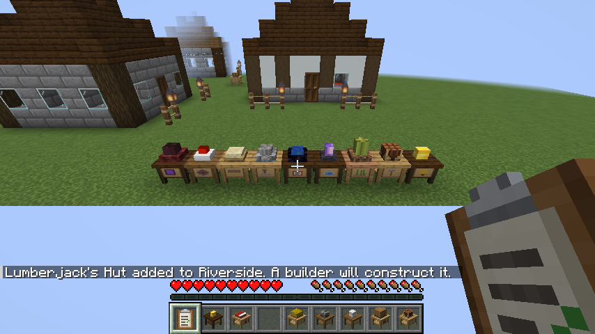

Every hut is a wooden workbench with its job sign on the front and a fitting prop on top
(a log stump for the Lumberjack, a hay bale for the Farmer, a cake for the Baker, and so on).

### Windows

| Action | Opens |
|---|---|
| Right-click a hut | The **hut window**. **Overview** shows level, residents, workers and their status. **Construction** shows the work order, a progress bar and the materials list, with how many of each the Builder's Huts already hold, and the **Repair** and **Deconstruct** buttons. **Requests** lists what the hut is waiting for. Depending on the hut there are also **Settings** ([hut settings](#hut-settings)), **Orders** (postbox), **Recipes** ([teaching recipes](#teaching-recipes)) and **Research** (University). Buttons: **Inventory**, **Build** / **Upgrade** / **Cancel Order**. |
| Right-click the Town Hall | The hut window plus a **Citizens** tab (every citizen with job, happiness and status) and a **Colony** tab (owner, statistics, decorations, default style, raids on or off, renaming the colony, permissions and open work orders). |
| Use the Clipboard | Every open request of your colony, from anywhere ([requests](#requests)). |
| Sneak + right-click a hut | The hut's inventory directly. |
| Right-click a citizen | The **citizen window**: a model preview, health, food and happiness bars, status, home, workplace and carried items. |

Open windows refresh every two seconds, so you can watch construction progress live.

When you join a world or server, a short welcome message in chat shows the mod version and
links to the releases and the changelog.

| | |
|---|---|
| 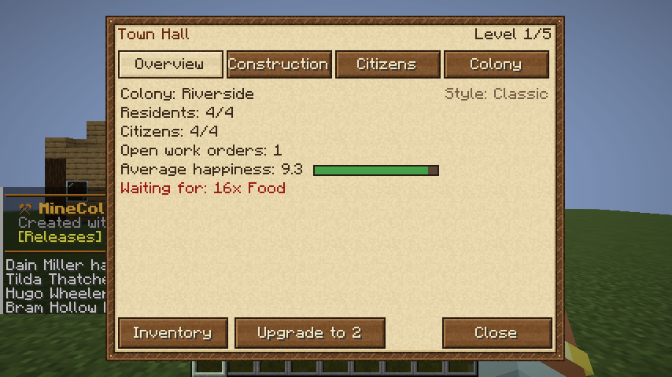 | 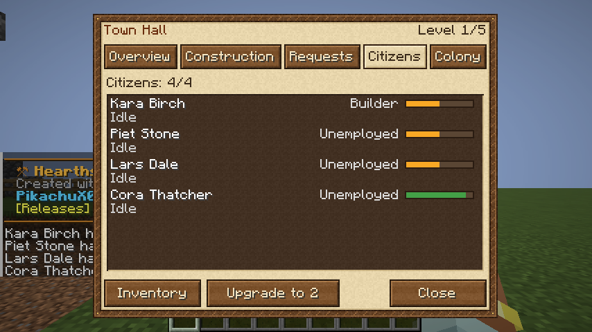 |
| 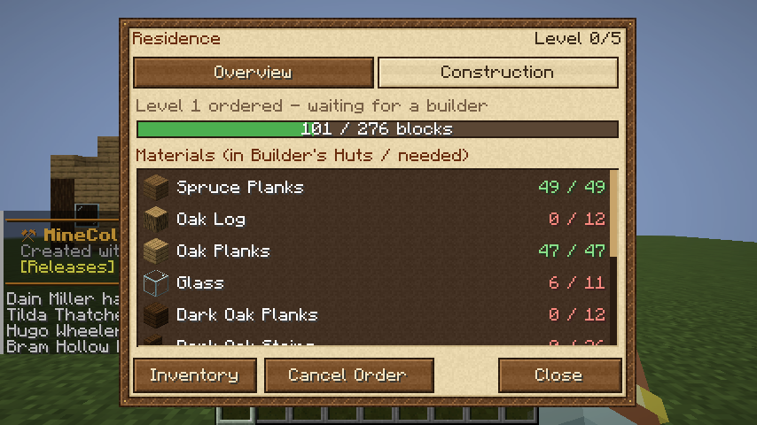 | 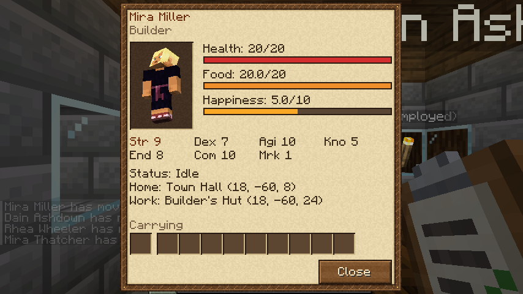 |

### Gameplay

| Feature | Details |
|---|---|
| **Colonies** | Place a **Town Hall** to found a colony (one per player). It claims a 129×129 area (`colonyRadius` in the [config](#configuration)). Town halls must be at least 144 blocks apart (twice the radius plus 16). |
| **Protection** | Inside a colony, players can only do what its [permissions](#permissions) allow them. Creative-mode operators can bypass this. |
| **Citizens** | New citizens arrive every minute while there is free housing. Each one has a name, a skin, saturation and happiness. Many jobs come with their own outfit, in a male and a female version ([outfits](#job-outfits)). If a citizen goes missing (for example, unloaded), the colony respawns them at the town hall. If one dies, the owner is notified. |
| **Housing** | Town Hall: 4 settlers per level (also 4 before it is built). Residence: 2 beds per level. |
| **Food** | Citizens get hungry. They eat food stored in their home, the Town Hall, a Residence or a Warehouse. Starving citizens become unhappy and take damage. |
| **Happiness** | Housing, employment and food raise happiness. Happiness scales work speed. |
| **Day/night** | Workers go home to sleep at night. Guards stay on duty. |
| **Lumberjack** | Needs an **axe** in the hut. Fells nearby trees from the top down, picks up drops, replants saplings and brings the wood back. |
| **Farmer** | Needs a **hoe** in the hut. Tills, sows and harvests a field that surrounds the farmer's building, at floor level, and the fields marked with **Scarecrows** ([fields](#fields)). Takes seeds from the hut, and uses bone meal from the hut on growing crops. Field width = 2 + level blocks. |
| **Miner** | Needs a **pickaxe** in the hut. Digs a 2-high tunnel out of the front of the miner's building (16 blocks per level), mines exposed ores and places torches from the hut. Place the hut underground. |
| **Guard Tower** | Employs one guard per level. Guards attack hostile mobs, including raiders, and have +20 health, +6 armour and +2 attack. Their class (knight, ranger or druid) and orders are chosen in the tower's Settings tab ([guards](#guards)). Other citizens flee from monsters. |
| **Raids** | See [Raids](#raids) below. |
| **Research** | See [Research](#research) below. |
| **Warehouse** | The colony's central storage. Its building is lined with barrels, and the hut plus every chest and barrel inside the building count as storage. Citizens can eat from it. |
| **Deliveryman** | Carries items between the Warehouse and the huts. Brings builders their missing materials, workers their tools (axe, hoe, pickaxe, sword, fishing rod), seeds and torches, homes their food and the cook raw food and coal. Also empties worker huts into the Warehouse. Needs a Warehouse. The **Requests** tab shows what each hut is waiting for. |
| **Cook** | Loads the smokers inside the kitchen (one per hut level) with raw food (beef, pork, chicken, mutton, rabbit, cod, salmon, potatoes, kelp) and coal or charcoal from the hut, and stores the meals in the hut. Citizens eat there too, and prefer cooked meals. |
| **Baker** | Turns wheat stored in the Bakery into bread: 3 wheat per loaf, one loaf per hut level each batch. Citizens eat there too. |
| **Smelter** | Runs the furnaces inside the Smeltery (one per hut level), smelting ores, raw metals and sand into ingots and glass with coal or charcoal from the hut. |
| **Shepherd** | Needs **shears** in the hut. Shears the sheep around the hut and breeds them with wheat while the flock is smaller than 2 + 2 × hut level. Build a pen near the hut so the sheep stay in range. |
| **Composter** | Fills the composters in its building (two per hut level) with plant waste such as leaves and saplings, and collects the bone meal. Farmers use bone meal on growing crops. |
| **Sawmill** | Saws logs into what builders and other huts are waiting for and the warehouse can't supply: planks, sticks, slabs, stairs, doors, trapdoors, fences and fence gates of every wood type. Otherwise it keeps 64 planks in the warehouse. |
| **Cowhand** | Needs **buckets** in the hut. Milks the cows around the hut (each cow every few minutes) and breeds them with wheat while the herd is smaller than 2 + 2 × hut level. Keep the cows in a pen near the hut. |
| **Chicken Herder** | Breeds the chickens around the hut with seeds and gathers the eggs and feathers they leave lying around. |
| **Swineherd** | Needs a **sword or axe** in the hut. Breeds the pigs around the hut with carrots, potatoes or beetroot; once the herd reaches 2 + 2 × hut level, it butchers an adult pig for pork. |
| **Stonemason** | Cuts stone, cobblestone, sandstone, deepslate, bricks and more into the stone parts huts are waiting for and the warehouse can't supply (stone bricks, stairs, slabs, walls, cut and polished blocks). |
| **Florist** | Needs **bone meal** in the hut. Uses it on the grass around its building so flowers grow, and picks the flowers. |
| **Dyer** | Makes the dyes, coloured wool and beds huts are waiting for, such as the Concrete Mixer's dyes (flowers into dyes, white wool into coloured wool, wool and planks into beds). Otherwise turns flowers into dyes. |
| **Beekeeper** | Harvests the full beehives in the Apiary (one per level) and bee nests nearby: honey bottles when it has glass bottles, honeycomb with **shears** otherwise. Bees are not angered. Bring your own bees. |
| **Rabbit Herder** | Needs a **sword or axe** in the hut. Breeds the rabbits around the hutch with carrots or dandelions; once the warren reaches 2 + 2 × hut level, takes an adult rabbit for meat and hide. |
| **Glassblower** | Smelts sand into glass in the furnaces of its workshop (one per hut level) with coal or charcoal, and makes the glass panes and stained glass huts are waiting for. |
| **Concrete Mixer** | Mixes 4 sand, 4 gravel and a dye into 8 concrete powder and sets the powder into concrete. |
| **Planter** | Looks after the sugar cane, cactus and bamboo you plant around the hut: cuts them down to their base when they grow (so they grow back) and spreads each kind to free spots next to it, up to 8 plants at level 1 and 24 at level 5. Keeps a few cuttings for planting and brings the rest to the hut. |
| **Alchemist** | Fills glass bottles with water, brews awkward potions with nether wart and finishes them with the brewing ingredients in the hut (sugar for swiftness, glistering melon for healing, ...), three bottles at a time. One blaze powder fuels 20 batches. You choose the potions by the ingredients you supply. |
| **Enchanter** | Enchants books with lapis lazuli, like an enchanting table. Higher hut levels give stronger enchantments (power 9 at level 1 up to 30 at level 5) and use more lapis (1 to 3 per book). |
| **Crusher** | Crushes cobblestone into gravel or sand (a hut setting); makes sand whenever another hut (Glassblower, Concrete Mixer) is short of it. Asks for cobblestone. |
| **Sifter** | Sifts gravel, sand or dirt (a hut setting): gravel turns up flint, nuggets, coal and, at higher levels, raw copper and iron, emeralds and diamonds; sand gives clay, gold, cactus, glowstone and prismarine shards; dirt gives seeds, potatoes, carrots, bones and saplings. Higher hut levels find more. |
| **Mechanic** | Crafts redstone parts, rails, iron doors, trapdoors and bars, lanterns, torches, buckets, shears and flint and steel with the game's recipes, for whatever huts are short of (the miners' torches, a builder's lanterns, the cowhand's buckets). Asks for iron, redstone, coal, sticks and cobblestone. |
| **Netherworker** | Goes on expeditions to the Nether through the portal in the Nether Mine: with a sword and 8 food they are away for about two minutes and come back with netherrack, quartz, soul sand and gold nuggets; nether wart and glowstone from level 2, magma cream from 3, blaze rods from 4 and ghast tears at level 5. Only sets out early enough to be back by nightfall. A trip under way carries on after the world is reloaded. |
| **Blacksmith** | Forges the tools and weapons huts ask for (axes, hoes, pickaxes, shovels, swords), plus iron armour and shields, with the game's recipes. Prefers iron, then stone; diamond gear from hut level 3. Asks for iron ingots and sticks. |
| **Fletcher** | Makes bows, crossbows, arrows, fishing rods and leads for the huts that ask for them, such as the fisherman's rod. Asks for sticks, string, flint and feathers. |
| **Stone Smelter** | Runs the furnaces of the Stone Smeltery (one per level): cobblestone into stone, clay into bricks and terracotta, netherrack into nether bricks, cobbled deepslate into deepslate, sandstone, quartz and basalt into their smooth forms. Asks for cobblestone and fuel. |
| **Guard (Barracks)** | The Barracks employs 2 guards per level (up to 10), with the same classes and orders as Guard Tower guards. |
| **Healer** | Works at the Hospital and heals hurt citizens around it, and cures the sick ([illness](#illness)). Citizens below half health leave their work and go to a staffed Hospital until they have mostly recovered. |
| **Quarrier** | Digs an open pit behind the Quarry, layer by layer from the top: 5x5 and 8 deep at level 1, up to 13x13 and 24 deep at level 5. Brings the stone and ores to the hut. Needs a pickaxe. |
| **Librarian** | Studies the Library's books. While a staffed Library has books, every citizen gains skill experience 25% faster per Library level; one book is used up every quarter day. |
| **Teacher** | Keeps the School open. While it is staffed, children go there during the day, learn a little of every skill and grow up twice as fast. |
| **Undertaker** | Buries the colony's dead at the Graveyard, which ends the mourning. Sometimes (4% per Graveyard level) the departed comes back to life instead. |
| **Fisherman** | Needs a **fishing rod** in the hut. Finds open water near the hut, fishes from the shore using the vanilla fishing loot, and brings the catch home. |
| **Builder** | Every hut is built from a blueprint (schematic) by a **Builder**. A placed hut starts at level 0 and gets a work order for level 1. The builder takes building materials from the **Builder's Hut** inventory and places the blueprint block by block, clearing whatever is in the way. Open a hut to see progress and the materials still needed. |
| **Upgrades** | Huts go up to level 5, and each level has a bigger building. Open a hut and click **Upgrade** to create a work order. Other huts can't exceed the Town Hall's level, and a builder can only build up to its own hut's level (level 1 is always possible). |

### Recipes

Each hut is 8 planks around a center item:

| Hut | Center item |
|---|---|
| Town Hall | book (cobblestone in the edge slots) |
| Residence | any bed |
| Lumberjack | wooden axe |
| Farmer | wooden hoe |
| Miner | wooden pickaxe |
| Guard Tower | wooden sword |
| Warehouse | chest |
| Builder's Hut | wooden shovel |
| Deliveryman's Hut | leather |
| Cook's Hut | smoker |
| Fisherman's Hut | fishing rod |
| Bakery | wheat |
| Smeltery | furnace |
| Shepherd's Hut | shears |
| University | book |
| Composter's Hut | composter |
| Sawmill | iron axe |
| Cowhand's Hut | bucket |
| Chicken Herder's Hut | egg |
| Swineherd's Hut | carrot |
| Stonemason's Hut | stonecutter |
| Florist's Hut | poppy |
| Dyer's Hut | loom |
| Apiary | beehive |
| Rabbit Hutch | dandelion |
| Glassblower's Hut | glass |
| Concrete Mixer's Hut | cauldron |
| Planter's Hut | sugar cane |
| Alchemist's Hut | brewing stand |
| Enchanter's Hut | lapis lazuli |
| Crusher's Hut | grindstone |
| Sifter's Hut | iron bars |
| Mechanic's Workshop | redstone dust |
| Nether Mine | flint and steel |
| Blacksmith's Hut | anvil |
| Fletcher's Hut | fletching table |
| Stone Smeltery | blast furnace |
| Barracks | iron sword |
| Hospital | golden apple |
| Quarry | iron pickaxe |
| Stash | barrel |
| Library | bookshelf |
| Combat Academy | iron sword |
| Archery | target |
| School | book and quill |
| Tavern | barrel |
| Graveyard | mossy cobblestone |
| Postbox | paper |
| Mystical Site | amethyst shard |

The **Scarecrow** is crafted from a carved pumpkin (top middle), a hay bale (center), and sticks
on its sides and below.

The **Rope Fence** is crafted from 4 sticks and 2 string (sticks on the sides, string in the
middle column) and makes 4 fences.

The **Clipboard** is a stick on the left, right and bottom, paper in the middle and an iron
nugget on top.

All huts are also in the **Hearthstead** creative tab.

### Commands (`/hearthstead` or `/hs`)

- `info`: overview of your colony and its buildings
- `citizens`: lists citizens with job, food, happiness and status
- `list`: lists all colonies on the server
- `rename <name>`: renames your colony (owner only)
- `addofficer <player>` / `removeofficer <player>`: officers can build in and manage the colony (also on the Permissions screen)
- `upgrade <x y z>`: creates a work order to build or upgrade a hut (same as the **Build** / **Upgrade** button in the hut window)
- `cancel <x y z>`: cancels a hut's work order
- `workorders`: lists the colony's open work orders
- `build <x y z>`: builds a hut's next level instantly, without materials (operators only)
- `raids <on|off>`: allows or prevents raids on your colony (owner only)
- `raid start [barbarians|pirates]` / `raid stop`: starts or stops a raid on the colony you are in (operators only)
- `event <merchant|festival>`: starts a colony event in the colony you are in (operators only)
- `research complete <research>`: finishes a research immediately (operators only)
- `delete <id>`: deletes a colony (operators only)
- `config reload`: reads `config/hearthstead.toml` again and reports invalid values (operators only)

## Abandoned settlements

Out in the world (plains, meadows, forests, taiga, savanna, snowy plains and cherry groves) you
may come across an **abandoned settlement**: an old camp around a **Town Hall** that belongs to
no one, with collapsed hut foundations, a cold fire pit and a chest of supplies (food, wood,
stone, tools, sometimes a hut block, a Build Tool or a Clipboard). They are about as rare as
pillager outposts and never generate right next to villages.

**Right-click the town hall** to claim it: your colony is founded right there, just as if you
had placed the town hall yourself (you cannot claim one if you already own a colony or it is
too close to another colony). `/locate structure hearthstead:abandoned_settlement` finds the
nearest one. Turn them off or change how often they appear in the `[worldgen]` section of the
config.

## Configuration

Settings are in `config/hearthstead.toml`, created with every option, its description, allowed
range and default on the first start. Edit a value after the `=` and restart the world, or run
`/hearthstead config reload`. Invalid values are reported and replaced by their defaults, and
options from newer versions are added automatically. On a server the server's file counts; only
`automaticUpdates` is read by each player's game.

### Settings screen

With [Mod Menu](https://modrinth.com/mod/modmenu) and [Cloth Config](https://modrinth.com/mod/cloth-config)
installed, open **Mods → Hearthstead → ⚙** for the same settings in game: one tab per section,
each option with its description as a tooltip and a Reset button. Chances are shown as
percentages. **Save & Quit** writes `config/hearthstead.toml` and applies the values right away
to worlds you host (singleplayer and LAN); on a server, the server's own file still counts.

| | |
|---|---|
| 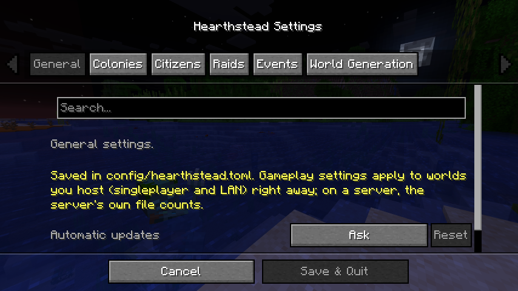 | 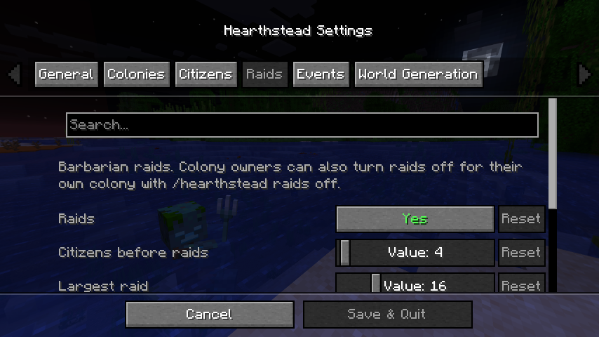 |

| Section | Option | Default | What it does |
| --- | --- | --- | --- |
| `general` | `automaticUpdates` | `"ask"` | `"on"`, `"off"` or `"ask"` on the title screen ([details](#automatic-updates)) |
| `general` | `welcomeMessage` | `true` | Welcome message with version and links when a player joins |
| `colonies` | `colonyRadius` | `64` | Blocks from the town hall to the colony's edge (32 to 256) |
| `citizens` | `newCitizenInterval` | `60` | Seconds between new settlers while there are free beds |
| `citizens` | `respawnDelay` | `30` | Seconds before a lost citizen returns to the town hall |
| `citizens` | `hungerRate` | `1.0` | How fast citizens get hungry (0 = never) |
| `citizens` | `workSpeed` | `1.0` | How fast citizens build, craft, farm and so on |
| `citizens` | `researchSpeed` | `1.0` | How fast research progresses |
| `citizens` | `illnessChance` | `0.03` | Chance each morning that a citizen falls ill (0 turns illness off) |
| `citizens` | `contagionChance` | `0.2` | Chance each morning that a sick citizen infects each person they live with |
| `raids` | `enabled` | `true` | Whether colonies can be raided at all |
| `raids` | `minCitizens` | `4` | Citizens a colony needs before raids start |
| `raids` | `maxRaiders` | `16` | Largest raid |
| `raids` | `nightlyChance` | `0.2` | Chance of a raid at nightfall |
| `raids` | `chanceIncreasePerQuietNight` | `0.15` | Added to the chance after every night without a raid |
| `raids` | `pirates` | `true` | Pirate raids on colonies near water |
| `raids` | `pirateChance` | `0.5` | Share of raids by pirates for colonies near water |
| `events` | `wanderingMerchantChance` | `0.1` | Chance each morning of a merchant visit |
| `events` | `festivalInterval` | `7` | Days between harvest festivals (0 = none) |
| `events` | `birthChance` | `0.25` | Chance each morning of a birth (two adults at home, a free bed) |
| `events` | `visitorChance` | `0.5` | Chance each morning of a visitor at a tavern with a free room |
| `worldgen` | `abandonedSettlements` | `true` | Generate abandoned settlements in new chunks |
| `worldgen` | `settlementChance` | `0.35` | How likely each possible spot gets one |

## Building styles

Every hut can be built in one of five styles: **Classic**, **Medieval** (stone brick and
spruce), **Desert** (sandstone with flat roofs), **Nordic** (spruce and cobblestone) and
**Timber** (half-timbered: stone base, white plaster in a dark oak frame). Buildings keep the
same size and interior in every style, and each has a rope-fenced front yard with lanterns
by the entrance.

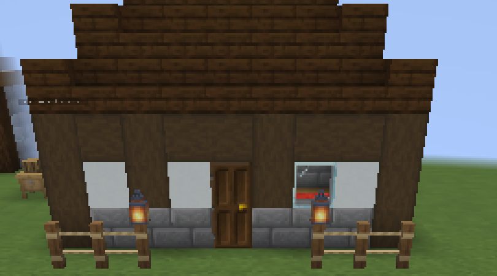

- **Colony default:** new huts get the colony's default style. Change it with **Change Style** on
  the Town Hall's Colony tab.
- **Per building:** the Build Tool's style switcher (◀ Style ▶) previews a hut in each style
  before placing it, and picks the style for an upgrade. Each building remembers its style.

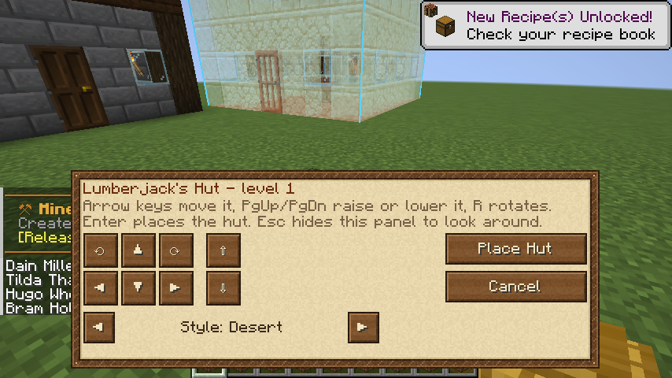

## Build Tool

Craft the **Build Tool** from two sticks and a sheet of paper (diagonally, paper on top), or
take it from the creative tab.

1. Right-click a block with the Build Tool and choose a hut from your inventory.
2. The hut's building appears as a see-through ghost, with an outline of the area the
   builder will use. Blocks in red show where something is in the way; the builder will
   clear it.
3. Move it with the arrow buttons or arrow keys, raise or lower it with PgUp/PgDn and
   rotate it with R.
4. Press **Place Hut** (or Enter). The hut is placed and the builder gets a work order.

Esc hides the controls so you can look around. Right-click with the tool to show them
again, or right-click a block to move the preview there. Right-clicking an existing hut
previews its next level, with an **Order Upgrade** button and a **Move Hut** button
([moving huts](#repairing-taking-down-and-moving-huts)).

| | |
|---|---|
| 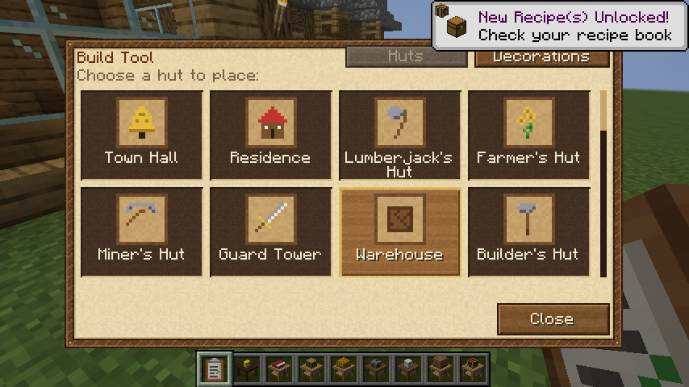 | 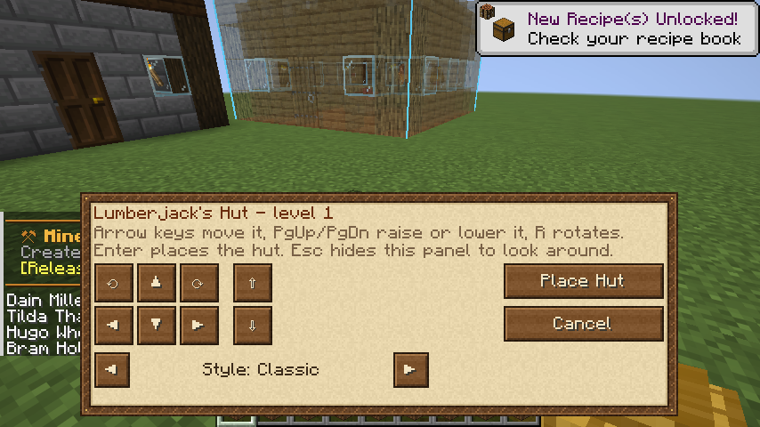 |

## Repairing, taking down and moving huts

Builders do more than build:

- **Repair:** the **Repair** button on a hut's Construction tab orders a builder to put back
  whatever is missing or wrong in the hut's current level, with materials from the Builder's
  Hut like any construction.
- **Deconstruct:** the **Deconstruct** button (click twice to confirm) orders a builder to take
  the hut down from its own layer up; the floor stays. Each block comes back as an item, and
  the hut block, the hut's contents and anything stored in its chests and barrels go to the
  Builder's Hut. The town hall cannot be taken down.
- **Move:** right-click a hut with the Build Tool, press **Move Hut**, move and turn the preview
  and press **Move Here**. The hut block moves at once with its contents, workers and residents
  and keeps its level; builders then clear the old site (the materials go to the Builder's Hut)
  and rebuild the hut's level at the new spot. The town hall cannot be moved.

Any builder can take these jobs, whatever the level of their hut. Cancel one with the hut's
**Cancel Order** button.

## Decorations

Decorations make a colony look lived in: a **Well**, a **Fountain**, a **Lamppost**, a
**Bench**, a **Flower Bed**, a **Market Stall**, a **Pavilion**, a **Campfire Circle**, a
**Banner Pole**, a **Hay Pile**, a **Path**, a **Path Crossing**, a **Wall** and a **Gate**.
Each comes in every building style.

1. Right-click a block with the Build Tool and switch to the **Decorations** tab.
2. Pick a decoration, then move, rotate and restyle the preview like a hut.
3. Press **Order Build**. A builder builds it like a hut level, with materials from the
   Builder's Hut (paths and grass take dirt; water is free).

A decoration needs no hut block, but it has to fit inside the colony without overlapping a hut
or another decoration. Its whole area is cleared first, so it also levels the ground.

Every decoration that is still mostly standing makes all citizens a little happier: +0.25
each, up to +1. A decoration that has been mostly torn down is forgotten. The town hall's
Colony tab shows the bonus and lists ordered decorations among the work orders, with a ✕ to
cancel them.

| | |
|---|---|
| 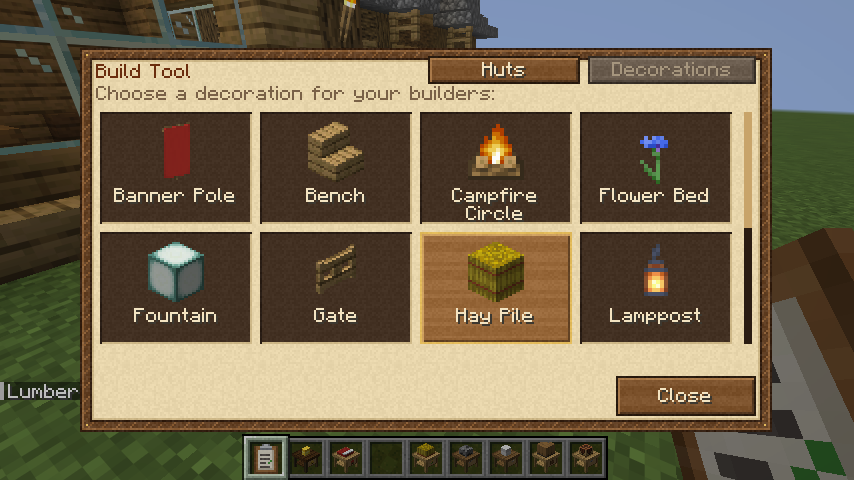 | 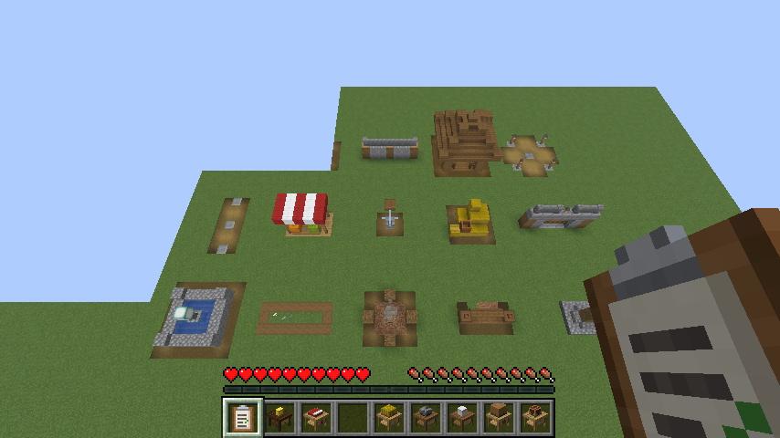 |

## Permissions

Open the **Town Hall**, go to the **Colony** tab and press **Permissions**. Players have one of
four ranks:

- **Owner** and **Officers** may do everything, including managing huts and the colony.
- **Friends** and **Visitors** (everyone else) may do what the owner allows:

| Permission | Friends by default | Visitors by default |
| --- | --- | --- |
| Break blocks (hut blocks always need an officer) | no | no |
| Place blocks and change them with items (hoes, axes, buckets, bone meal, ...) | no | no |
| Use doors, trapdoors, gates, buttons, levers, bells, beds and crafting tables | yes | no |
| Open chests, barrels, furnaces and other containers, and hut inventories | yes | no |
| Hurt citizens and animals | no | no |
| View hut windows and hand in items for requests | yes | no |

The owner adds a player (who must be online) as a friend or officer by name, switches members
between officer and friend with ⇅, removes them with ✕, and clicks Yes/No to change what friends
and visitors may do. Officers can open the screen to look but not change it.

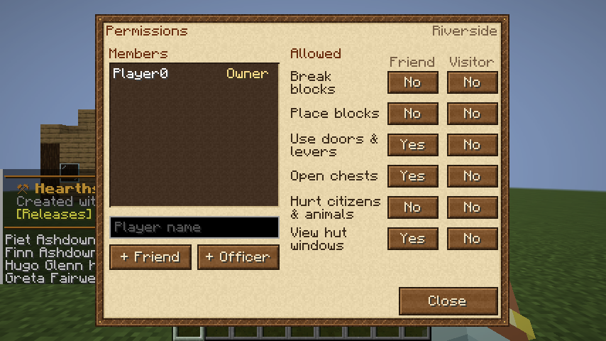

## Postbox

A **Postbox** has no worker. On its **Orders** tab, type an item's name or id (`bread`,
`minecraft:torch`) and a count and press **Order**: up to 8 orders at once. The deliveryman
brings them from the Warehouse; what the warehouse lacks is made by the crafters or shows up in
the Requests tab like any request. When an order has fully arrived, members get a message and
the items wait in the postbox.

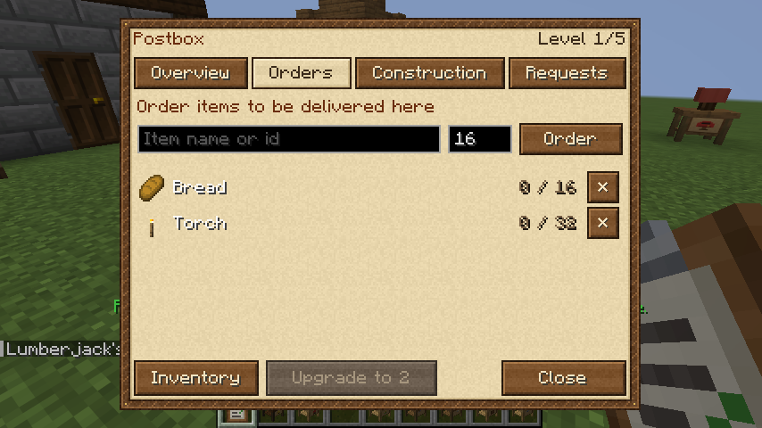

## Teaching recipes

The **Sawmill**, **Mechanic's Workshop**, **Blacksmith's Hut** and **Fletcher's Hut** make their
trade's goods on their own whenever a hut is short of them. On their **Recipes** tab you can teach
them more: type anything a crafting table makes (`chest`, `minecraft:barrel`, `Bowl`) and press
**Teach**. Each hut learns two recipes per level.

- With **Keep** at 0 (shown as —) the worker makes it when a hut or a postbox asks for it.
- With **Keep** above 0 the worker also keeps that many in the warehouse (and its own hut).
- The hut asks for the ingredients it lacks, so the deliveryman brings them from the warehouse;
  what is made goes to the warehouse like any product.

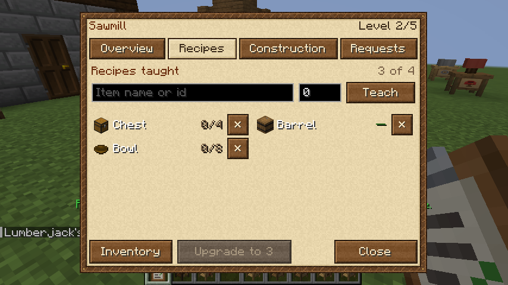

## Mystical Site

A **Mystical Site** has no worker. The colony's best one makes every citizen happier: +0.25 per
level, so +1.25 at level 5.

## Fields

Place a **Scarecrow** in the colony to mark a field: the 9 by 9 square around it, one block below
the scarecrow's feet. Each field is worked by the nearest Farmer's Hut with room for it: one
field per hut level (at least one), in the order the scarecrows were placed. The farmer works
the fields like the land around their hut: tilling dirt and grass, sowing, harvesting and using
bone meal. Breaking the scarecrow ends the field.

## Stash

A **Stash** is a drop-off box with no worker: put anything into it and the deliveryman carries
it to the Warehouse on their next round. Handy next to a mine entrance or a farm.

## Skills

Every citizen has seven skills, shown in the citizen window (hover over one for details):

| Skill | Used by |
| --- | --- |
| Strength | miners, lumberjacks, builders, quarriers, crushers, netherworkers |
| Dexterity | sawmill workers, stonemasons, dyers, glassblowers, concrete mixers, mechanics, blacksmiths, fletchers, cooks, bakers |
| Agility | deliverymen, fishermen, herders, beekeepers |
| Knowledge | researchers, enchanters, alchemists, healers, librarians |
| Endurance | farmers, planters, composters, florists, sifters, smelters |
| Combat | guards: +1 damage per 10 levels and +1 health per 5 levels |
| Marksmanship | guards: from level 5 they shoot arrows at enemies out of sword reach |

New settlers start between 1 and 10 (Marksmanship at 1). Working trains the job's skill, up to
level 50, and each level makes the citizen work 1% faster in that job. A **Library** with books
and a librarian speeds up learning for the whole colony.

**Guard training:** with a **Combat Academy** or an **Archery** in the colony, guards spend
every other stretch of a calm day training there instead of patrolling: Combat at the academy,
Marksmanship at the archery, faster at higher levels. Guard towers and barracks then ask for
arrows for their marksmen (the Fletcher makes them).


## Guards

Each Guard Tower and Barracks has a **Settings** tab with the class and orders of its guards.

| Class | Gear (requested from the colony) | How they fight |
| --- | --- | --- |
| **Knight** (default) | sword and shield | Up close. +4 armour, and the shield takes 40% of every hit. Knights who trained at the Archery also shoot arrows at enemies out of reach. |
| **Ranger** | bow and arrows | Keeps 5 to 14 blocks away and shoots; 3 damage per arrow plus 1 per 10 Marksmanship, faster with skill. 10% faster on foot. |
| **Druid** | nether wart (one per 4 potions) | Keeps its distance and throws harming potions (healing potions at the undead, which hurts them), and regeneration potions at hurt colonists nearby. Learns Knowledge by brewing. |

Rangers and druids without their gear fight up close like knights.

| Order | What the guards do when all is calm |
| --- | --- |
| **Patrol here** (default) | Walk around their building; train at the Combat Academy or Archery every other stretch of the day. |
| **Patrol colony** | Walk from hut to hut across the whole colony, and train like patrolling guards. |
| **Hold** | Stay at their building. |
| **Follow me** | Stay with the nearest colony member (owner or officer) within 64 blocks, and attack whatever hurts them or whatever they fight. Without anyone to follow, they hold their building. |

## Job outfits

Citizens wear an outfit for their job, drawn by **FallenStar114**, each in a male and a female
version. Citizens in other jobs, children and visitors wear one of Minecraft's default skins,
chosen to fit whether they are a man or a woman. Grown-up women have a small chest shape, cut
from their own skin so it matches every outfit.

| Job | Outfit |
| --- | --- |
| Alchemist, Baker, Beekeeper, Blacksmith, Builder, Cowhand, Deliveryman, Farmer, Fisherman, Miner, Researcher, Shepherd | their own |
| Sawmill worker | carpenter |
| Cook | chef |
| Knight (guard) | cavalry |
| Ranger (guard) | archer |


## Illness

Each morning a citizen may fall ill (3% by default; twice as likely when hungry or homeless, half
as likely with the Herbal Remedies research), and a sick citizen may pass it on to the people they
live with (20%). A sick citizen stops working, is slower and less happy, and sneezes now and then.

| Illness | Cure | Gets better by itself after |
| --- | --- | --- |
| Cold | Honey Bottle | 3 days |
| Fever | Golden Carrot | 4 days |
| Stomach bug | Milk Bucket | 2 days |

Sick citizens go to a Hospital with a healer, who cures them with the cure from the hospital's
stock (the hospital asks for one per sick citizen; empty bottles and buckets go back on its
shelf). Without a hospital they rest at home by day and get better on their own.

## Families, visitors and the dead

- **Children:** each morning (25% chance) a child may be born in a Residence where two adults
  live, if the colony has a free bed. Children are half size, don't work, and grow up after one
  in-game day (half a day with a staffed **School**, where they also pick up skills). Then they
  take a free job like any citizen.
- **Visitors:** a **Tavern** has one room per level. Each morning a visitor may arrive (50%),
  more skilled than ordinary settlers. Their window and name show what they ask to join: some
  bread, iron ingots or emeralds. Right-click them holding it to recruit them (needs a free bed);
  otherwise they leave after three days.
- **Expeditions:** the Tavern's **Send on expedition** button sends a visitor off until the next
  morning with 6 meals from the tavern (and a sword, if there is one). Usually (85%, 95% with a
  sword) they come back with finds in the tavern: emeralds, iron, gold, leather, saplings,
  seeds, books, ender pearls, now and then a saddle, name tag, golden apple or diamonds; more
  finds at higher tavern levels and with a sword. A visitor back from a trip stays three more
  days.
- **The dead:** when a citizen dies the colony mourns: everyone is 1 point less happy for a day.
  With a **Graveyard** and an undertaker, the dead are buried, which ends the mourning early, and
  now and then someone comes back to life.

## Hut settings

Some huts have a **Settings** tab in their window. Click a setting's button to switch to its next
value; the worker and the hut's requests follow it right away.

| Hut | Setting | Values |
| --- | --- | --- |
| Farmer | Crop | any seeds, wheat, carrots, potatoes, beetroot |
| Lumberjack | Replant saplings | yes / no |
| Miner | Place torches | yes / no (no torches are requested when off) |
| Crusher | Crush into | gravel, sand |
| Sifter | Sift | gravel, sand, dirt |
| Smeltery | Smelt | everything, ores & metals, sand only |
| Cook's Hut | Cook | all raw food, meat, fish, vegetables |
| Shepherd, Cowhand, Chicken Herder, Swineherd, Rabbit Hutch | Herd size | auto (grows with the hut level), 2 to 24 |
| (same) | Breed animals | yes / no (no feed is requested when off) |
| Guard Tower, Barracks | Guard class | knight, ranger, druid ([guards](#guards)) |
| (same) | Orders | patrol here, patrol the colony, hold, follow me |

The swineherd and rabbit herder butcher animals above the herd size.

## Requests

Every hut window has a **Requests** tab listing what that hut is waiting for: building
materials, tools, seeds, fuel, food and so on. The town hall's tab lists every open request in the
colony, with the hut that asked. Each request shows who it is waiting on:

- **Being delivered** (green): the Warehouse has it and the deliveryman will bring it.
- **Being crafted at the ...** (blue): the Warehouse has none, but one of the colony's crafting
  huts (Sawmill, Stonemason, Dyer, Glassblower, Crusher, Mechanic, Blacksmith, Fletcher or Stone
  Smeltery) has a worker and makes it. The deliveryman
  fetches it from the crafter as soon as it is made.
- **In the warehouse - needs a deliveryman** (yellow): build a Deliveryman's Hut.
- **Needs you** (red): nothing in the colony can supply it, so it is up to you. These are listed first.

If you carry something that fits a request, press **Give** next to it to hand it in straight
from your inventory (up to the amount asked for). From the town hall you can hand in items for
any hut of the colony.

The **Clipboard** shows the same list as the town hall from anywhere: use it (right-click) to
see what your colony needs, and press **Give** to hand items in without walking back. It shows
the colony you own or are an officer of.

## Research

Build a **University** (8 planks around a book). It employs one **Researcher** per level,
who studies during the day and adds research points to the colony's active research.

Open the University and go to the **Research** tab. Select a research to see what it does
and what it costs, put the materials into the University's inventory and press
**Start Research**. One research runs at a time. A research needs its parent research and a
University of at least its tier.

Each branch has two paths. The research tree, with what each costs:

| Branch | Research (tier) | Effect | Cost |
|---|---|---|---|
| Civilian | **Community Spirit** (1) | +1 happiness | 16 bread |
| | **Comfortable Homes** (2, after Community Spirit) | +1 resident per Residence | 16 white wool, 4 books |
| | **Feast Days** (3) | hunger 30% slower | 32 bread, 1 cake, 8 books |
| | **Spacious Homes** (4) | another +1 resident per Residence | 64 oak planks, 4 white beds, 12 books |
| | **Golden Age** (5) | another +1 happiness | 2 gold blocks, 8 emeralds, 16 books |
| | **Herbal Remedies** (2, after Community Spirit) | well-fed citizens heal twice as fast | 8 poppies, 16 sweet berries, 4 books |
| | **Welcome Wagons** (3) | new settlers arrive twice as often | 1 oak boat, 4 chests, 8 books |
| | **Market Days** (4) | wandering merchants visit 3x as often | 4 emeralds, 4 barrels, 12 books |
| Technology | **Apprenticeship** (1) | +10% work speed | 8 paper |
| | **Swift Construction** (2, after Apprenticeship) | builders ~40% faster | 16 iron ingots, 4 books |
| | **Master Craftsmen** (3) | +15% work speed | 8 gold ingots, 1 diamond, 8 books |
| | **Delivery Carts** (4) | deliverymen walk 30% faster | 2 minecarts, 1 saddle, 12 books |
| | **Masterwork** (5) | +20% work speed | 4 diamonds, 1 anvil, 16 books |
| | **Bountiful Harvest** (2, after Apprenticeship) | 1 in 4 harvests gives an extra crop | 32 bone meal, 4 books |
| | **Skilled Lumberjacks** (3) | trees felled about a third faster | 2 iron axes, 8 books |
| | **Prospectors** (4) | 1 in 5 mined ores gives an extra drop | 2 iron pickaxes, 1 map, 12 books |
| Combat | **Militia Drills** (1) | guards +2 damage | 8 iron ingots |
| | **Chainmail Training** (2, after Militia Drills) | guards +4 armour | 24 iron ingots, 4 books |
| | **Stone Walls** (3) | raids 25% smaller | 64 stone bricks, 8 books |
| | **Plate Armour** (4) | guards +6 armour | 4 iron blocks, 12 books |
| | **Fortified Colony** (5) | raids another 25% smaller and half as frequent | 16 obsidian, 4 iron blocks, 16 books |
| | **First Aid** (2, after Militia Drills) | guards +10 health | 1 golden apple, 16 paper, 4 books |
| | **Swift Patrols** (3) | guards move 20% faster | 4 leather boots, 32 sugar, 8 books |
| | **Veteran Guards** (4) | guards +3 damage | 4 iron swords, 2 shields, 12 books |

Each research needs the one above it in its path. Research takes 300, 900, 2400, 4800 and 9000
points for tiers 1 to 5 (about 5, 15, 40, 80 and 150 minutes with one researcher; more
researchers and happier ones are faster).

| | |
|---|---|
| 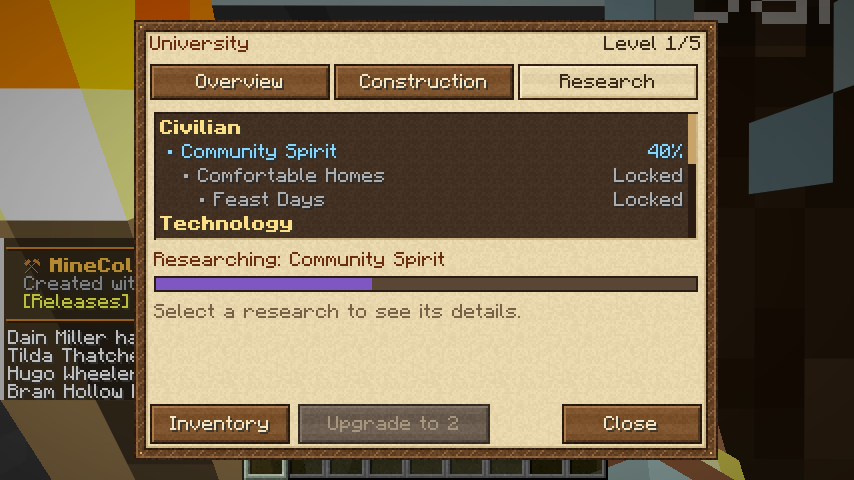 | 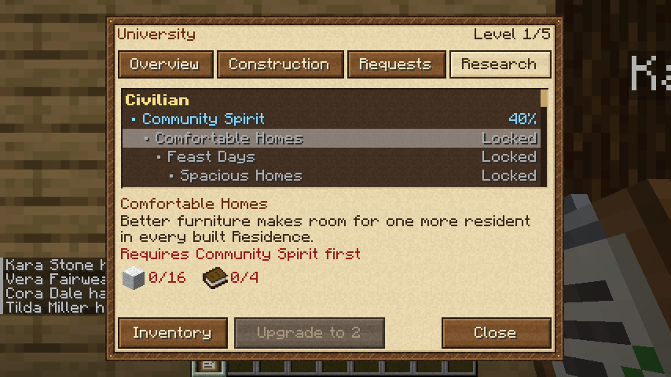 |

## Raids

At nightfall, a colony with at least 4 citizens may be raided by barbarians, or by **pirates**
if there is water near the colony's edge. The chance grows with every night without a raid.

- **Warning:** members get a chat warning with the direction of the attack, a raid horn
  sounds, and a boss bar shows the raiders left to everyone inside the colony.
- **Attack:** the raiders gather at the edge of the colony, march on the Town Hall and attack
  citizens and players on the way. Guards fight back; everyone else flees.
- **End:** the raid ends when all raiders are dead, or at sunrise when the survivors retreat.
- **Size:** 2 raiders plus 1 for every 2 citizens, up to 16. Archers join from 6 citizens, and a
  Chief (or a Pirate Captain) from 10.
- **Pirates:** for a colony with water nearby, half the raids (configurable) are by pirates. They
  come ashore between the water and the town hall, leaving two boats on the water, and fight
  with cutlasses and bows; the captain carries a diamond sword. When the raid ends, the boats
  are gone too.
- **Loot:** leather, iron nuggets and arrows. Chiefs drop iron ingots and emeralds, and
  sometimes a golden apple.
- **Controls:** owners can switch raids off on the Town Hall's Colony tab or with
  `/hs raids off`. There are no raids on Peaceful.

| | |
|---|---|
| 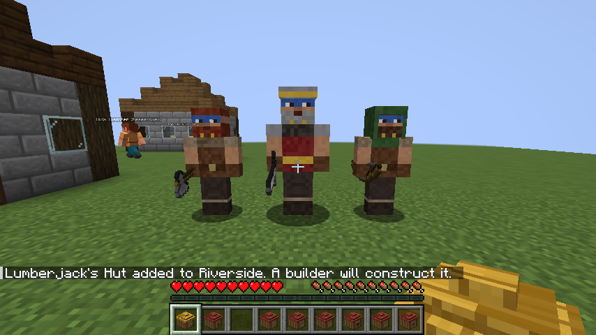 | 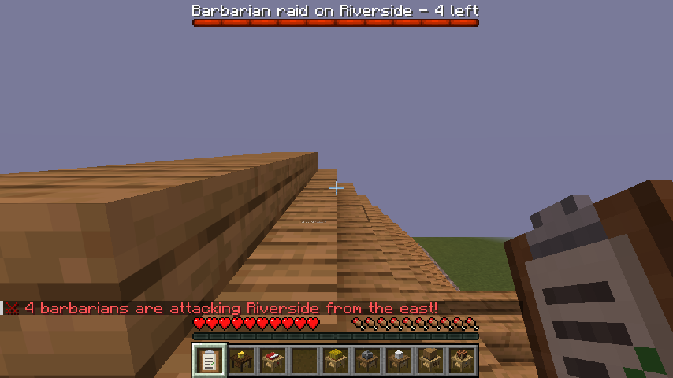 |
| 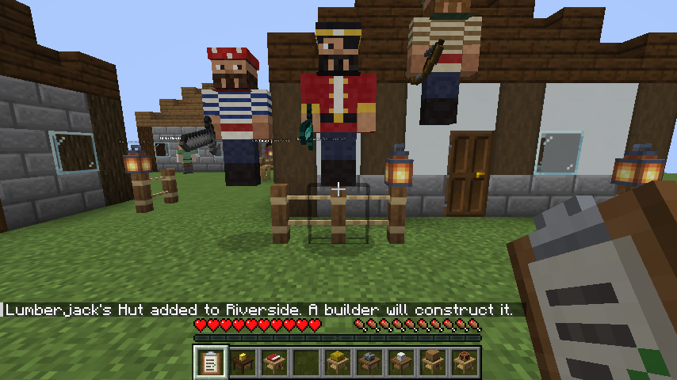 | |

## Colony events

Each morning, colonies with at least 3 citizens may have a visitor or a celebration:

- **Wandering merchant:** a wandering trader comes to the town hall and stays for a day
  (10% chance each morning).
- **Harvest festival:** every 7 days, citizens are 2 points happier until nightfall and
  fireworks go up over the town hall. The town hall window shows when a festival is on.

Both can be changed or turned off in the `[events]` section of the config, and operators can
start them with `/hs event merchant` or `/hs event festival`.

## Getting started

1. Place a **Town Hall** on open, fairly flat ground. Up to four settlers will arrive.
   Use the **Build Tool** to see how much room each building needs before placing it.
2. Put some food (bread, cooked meat, and so on) into the Town Hall's inventory.
3. Place a **Builder's Hut** and fill it with building materials. Open any hut
   to see which materials its blueprint still needs. A level 1 hut needs about 250-300 blocks:
   planks, logs, cobblestone or stone bricks, glass, stairs, a slab, a door and torches.
4. The builder builds its own hut first, then the Town Hall, then the other huts in order.
5. Huts need room: a level 1 building is 7×7, and level 5 is 13×13. The builder clears
   anything in the way, so leave space between huts.
6. Add a **Residence** for more citizens, and work huts such as a Lumberjack with an axe inside.
7. Add a **Warehouse** and a **Deliveryman's Hut**. From then on, stock the Warehouse instead
   of individual huts: the deliveryman brings materials, tools and food to wherever they
   are needed, and collects what the workers produce.

## Schematics (blueprints)

Blueprints are vanilla structure files. The built-in ones are at
`data/hearthstead/structure/huts/<hut>/level<1-5>.nbt`, where `<hut>` is one of
`townhall`, `residence`, `lumberjack`, `farmer`, `miner`, `guardtower`, `warehouse`, `builder`,
`deliveryman`, `cook`, `fisherman`, `baker`, `smelter`, `shepherd`, `university`, `composter`,
`sawmill`, `cowhand`, `chickenherder`, `swineherd`, `stonemason`, `florist`, `dyer`, `beekeeper`,
`rabbitherder`, `glassblower`, `concretemixer`, `planter`, `alchemist`, `enchanter`, `crusher`,
`sifter`, `mechanic`, `netherworker`, `blacksmith`, `fletcher`, `stonesmeltery`, `barracks`,
`hospital`, `quarry`, `stash`, `library`, `combatacademy`, `archery`, `school`, `tavern`,
`graveyard`, `postbox` and `mysticalsite`.

To use your own design:
1. Build it in a creative world and put the matching hut block where the hut should sit.
   The way the hut block faces is the building's front.
2. Save it with a **structure block** named `hearthstead:huts/<hut>/level<N>`, for example
   `hearthstead:huts/residence/level2`.
3. Run `/reload`. From then on, builders in that world use your design. To share a design
   between worlds, put the `.nbt` file into a data pack at the same path.

Other styles live at `data/hearthstead/structure/styles/<style>/<hut>/level<1-5>.nbt`
(structure name `hearthstead:styles/<style>/<hut>/level<N>`). A data pack can add a whole new
style by adding such a folder; it shows up in the style list automatically, and any hut or level
it lacks falls back to the classic blueprint.

Decorations live at `data/hearthstead/structure/decorations/<name>.nbt` (structure name
`hearthstead:decorations/<name>`) and `data/hearthstead/structure/styles/<style>/decorations/<name>.nbt`.
A data pack can add new ones the same way; they appear in the Build Tool after `/reload`. A
decoration has no hut block: its anchor is the middle of the structure, one block above its bottom
layer (which replaces the ground), and its front faces north. Its icon in the Build Tool comes
from `data/hearthstead/decoration_icons.json`, and its name from the translation key
`decoration.hearthstead.<name>`.

Air in the structure is cleared by the builder. Structure void is left untouched.
Block entity contents (for example, chest items) are not copied.

The default hut and decoration blueprints are generated by `tools/generate_schematics.py`.

## Building

Requires Java 21.

```sh
./gradlew build          # jar in build/libs/
./gradlew runClient      # dev client
./gradlew runServer      # dev server
./gradlew runGameTest    # automated in-game tests (server)
xvfb-run ./gradlew runClientGameTest   # opens every window in a real client and saves screenshots
```

The project builds against Fabric Loader 0.20.1 and Fabric API 0.141.6+1.21.11 with official
Mojang mappings; the jar runs on Fabric Loader 0.16.0 or newer. `tools/` holds the Python
scripts that generate the blueprints, textures and GUI sprites.

## Credits

- **PikachuX0303**
- **PerniciousPx**
- **FallenStar114**: also drew the citizens' job outfits

In collaboration with claude.

Inspired by [MineColonies](https://github.com/ldtteam/minecolonies) by the ldtteam; Hearthstead
is not affiliated with or endorsed by them.

## License

GPL-3.0 (see `LICENSE`), the same license MineColonies uses.

## Coming from the old name

Hearthstead was called "MineColonies (Unofficial Fabric Port)" up to version 0.16. Worlds from
those versions keep working: colonies, huts, items and citizens are carried over to the new
`hearthstead` ids automatically. Custom blueprints in data packs must move from
`data/minecolonies/` to `data/hearthstead/`, and the command is now `/hearthstead` (or `/hs`).
